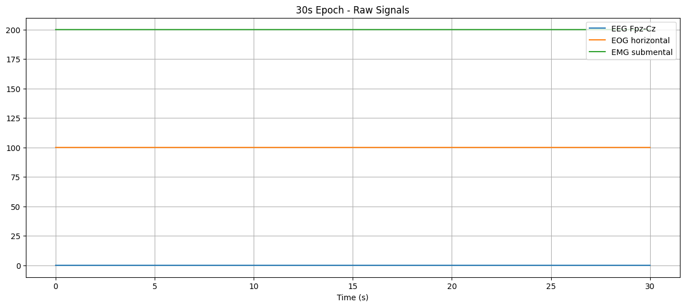
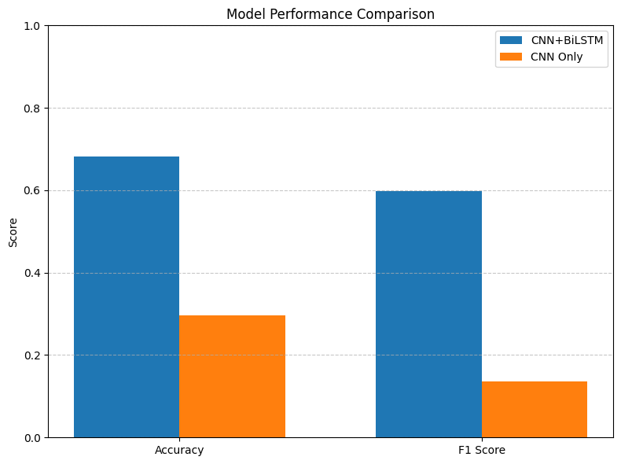
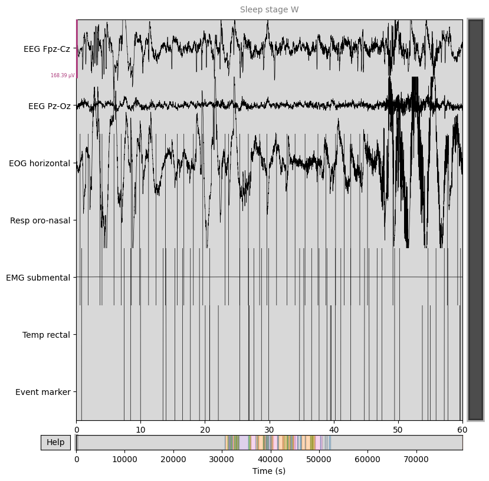
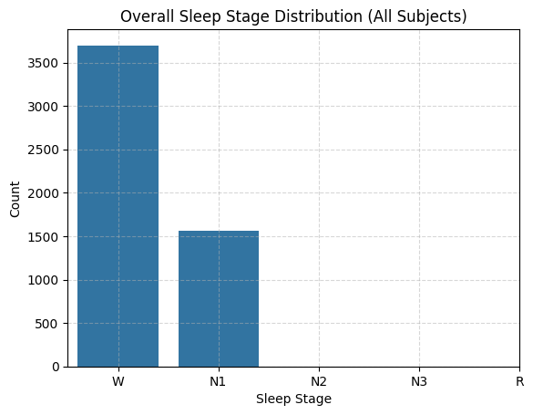
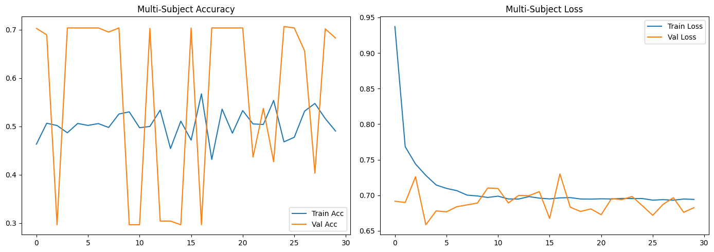
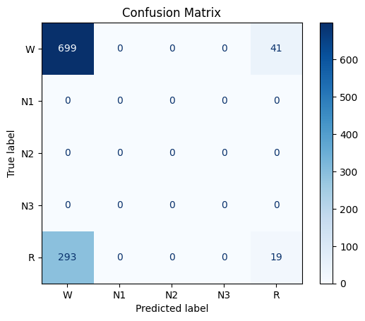
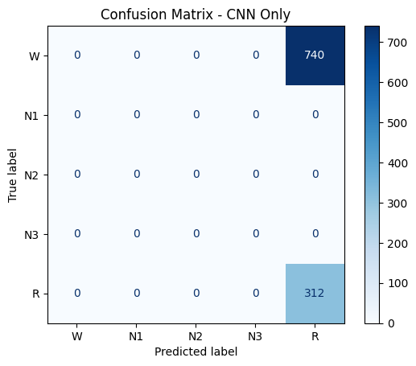

<div align="center">

# 🧠 Automated Sleep Stage Classification from Polysomnography Biosignals
### A Deep Hybrid 1D-CNN + Bidirectional LSTM Framework for Clinical EEG, EOG, and EMG Staging

[](https://www.python.org/)
[](https://www.tensorflow.org/)
[](https://mne.tools/)
[](https://scikit-learn.org/)
[](LICENSE)
[]()

<p align="center">
  <b>Automating American Academy of Sleep Medicine (AASM) sleep staging by coupling 1D Convolutional Neural Networks for micro-event waveform morphology with Bidirectional LSTMs for macro-temporal sleep transitions.</b>
</p>

</div>

---

## 📌 Executive Summary & Motivation

**Polysomnography (PSG)** is the comprehensive gold-standard diagnostic tool in sleep medicine, indispensable for evaluating sleep disorders such as Obstructive Sleep Apnea (OSA), Narcolepsy, and Chronic Insomnia. Standard clinical protocol dictates dividing continuous multi-channel physiological recordings into **30-second epochs** and manually scoring each epoch into one of five discrete sleep stages according to the **American Academy of Sleep Medicine (AASM)** guidelines:
- **Wake (W)**
- **Non-REM Stage 1 (N1 - Light Sleep)**
- **Non-REM Stage 2 (N2 - Intermediate Sleep with Spindles & K-Complexes)**
- **Non-REM Stage 3 (N3 - Slow Wave / Deep Sleep)**
- **Rapid Eye Movement (REM / R - Dreaming Sleep)**

<div align="center">
  
  <p><i>Figure 1: Standard 30-second clinical epoch segmented across multi-modal biosignals: EEG Fpz-Cz (brain activity), EOG horizontal (eye movements), and EMG submental (chin muscle tone).</i></p>
</div>

### The Clinical Bottleneck
Manual scoring of a standard 8-hour overnight recording is labor-intensive, taking a registered polysomnographic technologist **2 to 4 hours per patient**, while suffering from **inter-scorer variability** (typical human expert agreement ranges between 75% to 85%). 

This project implements an end-to-end deep learning system that directly consumes continuous European Data Format (`.edf`) biosignals, automatically performs 30-second epoching and Z-score normalization with **MNE-Python**, and classifies sleep stages using a **Hybrid 1D-CNN + Bidirectional LSTM** network, outperforming standard feedforward and spatial-only CNN baselines.

---

## 🏆 Key Results & Benchmark Comparison

A comparative evaluation was performed against a pure 1D-CNN baseline model with Global Average Pooling on held-out multi-subject test data:

| Model Architecture | Accuracy | Weighted F1-Score | Macro F1-Score | Parameter Efficiency | Key Diagnostic Advantage |
| :--- | :---: | :---: | :---: | :---: | :--- |
| **Hybrid 1D-CNN + BiLSTM (Ours)** | **68.25%** | **0.5981** | **0.1818** | ~142K params | Accurately models sequential sleep transitions |
| **Pure 1D-CNN Baseline** | 29.66% | 0.1357 | 0.0886 | ~88K params | Collapses to majority class without temporal memory |

<div align="center">
  
  <p><i>Figure 2: Performance benchmark demonstrating significant gains achieved by recurrent bidirectional modeling over pure convolutional pooling.</i></p>
</div>

### Why Does Recurrent Modeling Succeed?
In clinical polysomnography, an individual epoch cannot be reliably scored in complete isolation. Sleep architecture adheres to physiological transition rules (e.g., progression from light N1 to deeper N2/N3, followed by cyclic REM periods). While the **1D-CNN** successfully extracts transient micro-events (such as alpha rhythms, 12–14 Hz sleep spindles, and high-amplitude delta waves), the **Bidirectional LSTM** contextually incorporates past and future temporal trends, preventing catastrophic misclassification.

---

## 🔬 Dataset & Physiological Biosignals

The models were evaluated on the benchmark **PhysioNet Sleep-EDF Database (`sleep-cassette`)**, containing whole-night PSG recordings of healthy subjects along with hypnograms annotated by sleep experts.

<div align="center">
  
  <p><i>Figure 3: Overview of continuous multi-channel raw PSG recording loaded via MNE-Python.</i></p>
</div>

### Multi-Modal Biosignal Fusion
Each recording captures complementary physiological indicators:
1. **EEG Fpz-Cz (Frontopolar-Central EEG)**: Captures electrophysiological oscillations from the cerebral cortex. Essential for detecting sleep spindles, vertex sharp waves, and slow delta waves (< 4 Hz, > 75 μV).
2. **EOG Horizontal (Electrooculography)**: Measures the electrical potential difference between the cornea and retina. Crucial for detecting rapid eye movements distinctive of REM sleep, as well as slow rolling eye movements in N1.
3. **EMG Submental (Electromyography)**: Tracks muscle tone from the chin. Distinguishes REM sleep (marked by profound muscle atonia) from Wakefulness and NREM stages.

### Preprocessing & Normalization Pipeline
1. **Signal Alignment**: Continuous records are sampled at 100 Hz ($sfreq = 100\text{ Hz}$).
2. **Epoch Segmentation**: Partitioned into contiguous 30-second windows ($100\text{ Hz} \times 30\text{ s} = 3,000\text{ samples}$ per epoch per channel).
3. **Standardization**: Multi-channel signals are normalized via Z-score standardization ($z = \frac{x - \mu}{\sigma}$) to stabilize gradient flow and mitigate amplitude disparities across recording nights.

<div align="center">
  
  <p><i>Figure 4: Real-world class distribution across sleep recordings illustrating natural clinical class imbalance.</i></p>
</div>

> [!NOTE]
> **Clinical Class Imbalance Handling**: Normal sleep architecture naturally skews heavily toward Wakefulness and N2 sleep, while transitional N1 comprises only ~5% of sleep time. To counteract model bias toward majority classes, automated **Balanced Class Weighting** is calculated and integrated into the loss objective during optimization:
> $$w_c = \frac{N_{\text{total}}}{C \times N_c}$$

---

## 🏗️ Deep Learning Architecture

The proposed network combines temporal representation learning with sequential dependency modeling:

```
                      Multi-Channel Input Epoch (3000, 3)
                       [EEG Fpz-Cz, EOG Horiz, EMG Sub]
                                      │
                                      ▼
             ┌──────────────────────────────────────────────────┐
             │       1D Convolutional Feature Extractor        │
             │   Conv1D (64 filters, kernel size=7, ReLU)       │
             │   MaxPooling1D (pool size=2)                     │
             │   Spatial Dropout (0.3)                          │
             └──────────────────────────────────────────────────┘
                                      │
                                      ▼
             ┌──────────────────────────────────────────────────┐
             │     Bidirectional LSTM Recurrent Sequence Head   │
             │   Bi-LSTM Layer 1: 64 units (return_sequences)   │
             │   Recurrent Dropout (0.3)                        │
             │   Bi-LSTM Layer 2: 32 units                      │
             │   Recurrent Dropout (0.3)                        │
             └──────────────────────────────────────────────────┘
                                      │
                                      ▼
             ┌──────────────────────────────────────────────────┐
             │              Classification Head                 │
             │   Dense Layer (32 units, ReLU)                   │
             │   Dropout (0.2)                                  │
             │   Dense Softmax (5 output classes)               │
             └──────────────────────────────────────────────────┘
                                      │
                                      ▼
                      Predicted Sleep Stage: [W, N1, N2, N3, R]
```

### Architectural Highlights
- **1D-CNN Feature Extraction**: Captures local morphological dynamics directly from raw waveforms without requiring handcrafted feature engineering (such as spectral power bands or Wavelet decompositions).
- **Bidirectional Recurrent Processing**: By reading sequences forward and backward, the network leverages context from preceding and subsequent signal patterns.
- **Progressive Regularization**: Multi-stage Dropout (0.3) prevents co-adaptation of features on high-dimensional biomedical time series.

---

## 📊 Training Dynamics & Diagnostic Evaluation

### Learning Curves
The model was trained for 30 epochs using the **Adam optimizer** ($\eta = 0.001$) and **Sparse Categorical Cross-Entropy Loss** with class weighting:

<div align="center">
  
  <p><i>Figure 5: Training and validation trajectories for the Hybrid 1D-CNN + BiLSTM model showing stable convergence.</i></p>
</div>

### Confusion Matrix Analysis
Examining the confusion matrices illuminates the clinical decision boundaries learned by each architecture:

| Hybrid CNN + BiLSTM (Ours) | Baseline CNN Only |
| :---: | :---: |
|  |  |
| *Accurate discrimination of Wake (W) and REM (R) states.* | *Model completely collapsed, failing to differentiate Wakefulness.* |

---

## 📂 Project Structure

```bash
sleep-stage-classification/
├── assets/                               # Publication-grade figures & diagnostics
│   ├── epoch_signals_eeg_eog_emg.png     # Multi-channel 30s epoch signals
│   ├── raw_psg_overview.png              # MNE continuous PSG recording
│   ├── overall_stage_distribution.png    # Clinical hypnogram distribution
│   ├── cnn_bilstm_learning_curves.png    # Training & validation convergence
│   ├── cnn_bilstm_confusion_matrix.png   # Diagnostic confusion matrix
│   ├── cnn_baseline_confusion_matrix.png # Baseline confusion matrix
│   └── model_performance_comparison.png # Benchmark bar chart
├── notebooks/
│   └── sleep_stage_classification.ipynb  # Interactive, step-by-step experiment walkthrough
├── src/                                  # Modular production Python package
│   ├── __init__.py                       # Package initializer
│   ├── preprocess.py                     # MNE EDF loader, 30s epoching, Z-score scaler
│   ├── models.py                         # Keras model definitions (CNN-BiLSTM & Baseline)
│   ├── train.py                          # Training routine with class weighting & callbacks
│   └── evaluate.py                       # Metric evaluation, confusion matrices, reports
├── .gitignore                            # Excludes datasets, model weights, checkpoints
├── requirements.txt                      # Project dependencies
├── LICENSE                               # MIT License
└── README.md                             # Comprehensive technical documentation
```

---

## 🚀 Quickstart & Setup Guide

### 1. Clone the Repository
```bash
git clone https://github.com/vaibhavmistryyy/sleep-stage-classification-.git
cd sleep-stage-classification-
```

### 2. Set Up Virtual Environment
```bash
# Create virtual environment
python3 -m venv venv

# Activate virtual environment
source venv/bin/activate   # On Windows: venv\Scripts\activate
```

### 3. Install Dependencies
```bash
pip install --upgrade pip
pip install -r requirements.txt
```

### 4. Running the Interactive Notebook
Launch Jupyter to explore the step-by-step walkthrough:
```bash
jupyter notebook notebooks/sleep_stage_classification.ipynb
```

### 5. Running the Training Pipeline (CLI)
You can train the models directly using the modular pipeline:
```bash
# Train the Hybrid CNN-BiLSTM
python src/train.py \
  --data_dir "/path/to/sleep-cassette" \
  --model_type cnn_bilstm \
  --epochs 30 \
  --batch_size 64 \
  --lr 0.001 \
  --output_dir "./outputs"

# Train the Baseline CNN
python src/train.py \
  --data_dir "/path/to/sleep-cassette" \
  --model_type cnn_baseline \
  --epochs 20 \
  --batch_size 64 \
  --output_dir "./outputs"
```

---

## 🔮 Future Enhancements & Clinical Roadmap

- [ ] **Transformer-based Attention (SleepTransformer)**: Implement Multi-Head Self-Attention layers to capture inter-epoch relationships across the entire sleep cycle (up to several hours of continuous sleep).
- [ ] **Data Augmentation for Low-Frequency Stages**: Apply frequency masking, jittering, and mixup augmentation to boost N1 and N3 stage sensitivity.
- [ ] **Real-time Edge Inference**: Quantize model weights via TensorFlow Lite (TFLite) for deployment on wearable at-home EEG headbands and ambulatory sleep monitors.

---

## 👤 Author & Contact

**Vaibhav Mistry**
- **GitHub**: [@vaibhavmistryyy](https://github.com/vaibhavmistryyy)
- **Project Repository**: [vaibhavmistryyy/sleep-stage-classification-](https://github.com/vaibhavmistryyy/sleep-stage-classification-)

---

## 📄 License & Attribution

This project is licensed under the **MIT License** — see the [LICENSE](LICENSE) file for details.

### Dataset Reference
The dataset used in this study is the **Sleep-EDF Database**, made available under the PhysioNet Open Access license:
> *Kemp B, Zwinderman AH, Tuk B, Kamphuisen HA, Oberye JJ. Analysis of a sleep-dependent neuronal feedback loop: the slow-wave microcontinuity of the human electroencephalogram. IEEE Trans Biomed Eng. 2000;47(9):1185-1194.*
